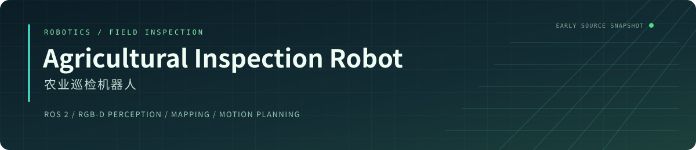

**面向农业巡检场景的 ROS 2 机器人项目**

机器人建模 · RGB-D 感知 · 目标跟随 · 建图定位 · 机械臂运动规划

[源码导览](docs/CODE_GUIDE.md) · [模块目录](#模块目录) · [版本说明](#版本说明)

## 项目介绍

本项目围绕农业巡检场景开展机器人系统开发，将机器人描述、环境感知、跟随控制与运动规划等模块组织在 ROS 2 工作空间中。

项目已完成。本仓库已上传早期工程结构及模块代码，最终版本暂未公开。

*A ROS 2 agricultural inspection robot project. This repository contains the early project structure and module implementations. The final version is not publicly available.*

## 模块目录

以下内容对应当前仓库中可查阅的早期实现。

| 模块 | 代码入口 | 主要内容 |
| --- | --- | --- |
| 机器人建模 | [`my_robot_description`](src/my_robot_description) | 底盘 URDF、状态发布与坐标变换 |
| RGB-D 目标感知 | [`my_robot_version`](src/my_robot_version) | YOLO 检测、彩色/深度图同步与目标三维位置估计 |
| 目标跟随控制 | [`my_robot_follow`](src/my_robot_follow) | 距离与角度控制、速度平滑和目标丢失处理 |
| 环境建图与定位 | [`my_robot_slam`](src/my_robot_slam)、[`my_robot_navi`](src/my_robot_navi) | RTAB-Map、视觉/ICP 里程计、EKF 与导航配置 |
| 机械臂运动规划 | [`my_arm_description`](src/my_arm_description)、[`my_arm_moveit_config`](src/my_arm_moveit_config) | 机械臂模型、MoveIt 与控制器配置 |
| 传感器接入 | [`imu_odometry`](src/imu_odometry)、[`ros2_astra_camera`](src/ros2_astra_camera) | IMU 数据与 Astra RGB-D 相机接入 |

`my_robot_version` 沿用早期代码中的包名，实际承担目标感知功能。

## 实现要点

- **RGB-D 感知**：同步彩色图与深度图，结合相机内参估计检测目标的三维位置，输出 ROS 目标消息。
- **跟随控制**：根据目标距离和横向偏差计算速度指令，使用输出限幅、加速度平滑与目标丢失处理组织控制逻辑。
- **建图与定位**：保留 RTAB-Map、RGB-D / ICP 里程计与 EKF 的启动和配置，以及 Nav2 相关配置。
- **运动规划**：通过机器人描述、MoveIt 配置和控制器配置组织机械臂规划入口。

上述实现要点均可在当前公开的早期源码中查阅。

## 技术组成

| 层次 | 技术与组件 |
| --- | --- |
| 系统组织 | ROS 2、colcon、ament、Python / C++ |
| 视觉感知 | YOLO / Ultralytics、OpenCV、RGB-D、`message_filters` |
| 建图与定位 | RTAB-Map、ICP、`robot_localization`、Nav2 配置 |
| 机器人描述与规划 | URDF、TF、MoveIt、RViz |
| 硬件接口 | Astra 相机驱动、IMU 串口 |

## 阅读与使用

建议先从模块目录了解结构，再按任务查阅[源码导览与历史环境参考](docs/CODE_GUIDE.md)，其中整理了依赖、构建示例、启动入口和需要迁移的配置。

当前版本保留了早期调试参数和本机路径，尚不能作为完整项目的直接复现包。源码导览中已标明地图路径、话题对接、Nav2 启动范围及地图写入行为，便于后续补充资料时核对。

## 版本说明

| 项目 | 状态 |
| --- | --- |
| 农业巡检机器人项目 | 已完成 |
| 当前公开代码 | 早期工程结构及模块代码 |
| 最终版本 | 暂未公开 |

历史提交保留在仓库中，用于追溯早期实现。

## 第三方组件与许可证

相机驱动、模型及其他第三方资源遵循各自的许可证与授权说明，详见对应子目录。本仓库根目录暂未声明覆盖全部组件的统一许可证。
